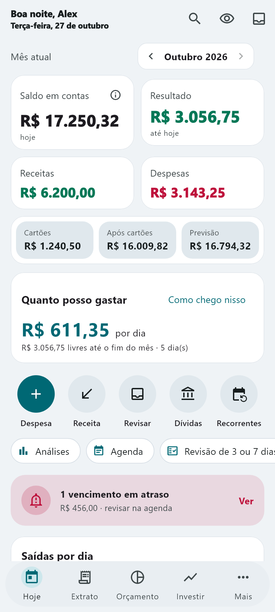
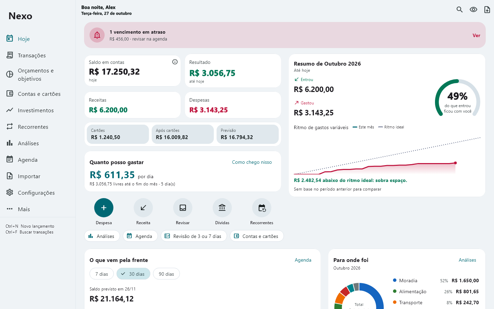

<div align="center">

# Nexo

### Seu dinheiro, com clareza.

Controle financeiro pessoal para entender o passado, acompanhar o presente e organizar os próximos compromissos.


[](LICENSE)

[Conheça o app](#um-painel-para-o-dia-a-dia) · [Telas](#telas) · [Estado](#estado-do-projeto) · [Executar](#executar-o-projeto) · [Servidor](#servidor-opcional) · [Documentação](#documentação)

</div>

## Um painel para o dia a dia

O Nexo reúne saldo, gastos, cartões, dívidas, investimentos e previsão de caixa em uma experiência compartilhada entre Android e Windows. O foco é reduzir trabalho manual sem perder a precisão dos registros.

- **Hoje:** saldo, quanto ainda dá para gastar no dia e no mês, ritmo ideal do mês, resumo de ontem e da semana, alertas de vencimento e de cobrança.
- **Extrato:** lançamentos por dia, busca, filtros, calendário de gastos e formulário rápido com lançamentos anteriores e atalhos de data.
- **Orçamento e planejamento:** orçamentos por categoria (proporcionais ou cheios no mês em que começam), visão por tipo de gasto (Custos fixos, Conforto, Metas, Prazeres, Conhecimento, Liberdade financeira) em % de uma renda de referência, recorrentes, assinaturas, objetivos e "Mês em revisão".
- **Contas e cartões:** transferências, faturas com a regra do fechamento do banco, pagamento de fatura sem duplicar gasto, empréstimos e dinheiro emprestado.
- **Investimentos:** carteira, proventos, comparação com o CDI e prazos de liquidez (D+0, D+2 úteis) para saber quanto dá para resgatar até uma data.
- **Open Finance (opcional):** movimentações dos bancos conectados chegam como sugestões na caixa "Para revisar", com conciliação automática; saldo do banco × saldo do Nexo com ajuste neutro; limite real e fatura oficial do cartão.
- **Assistente (opcional):** conector MCP com o qual o Claude faz no Nexo tudo o que a pessoa faz nas telas (98 ferramentas), com as mesmas regras do app. Cada pedido pode ser desfeito, repetir um pedido não duplica nada e tudo aparece em "Feito pelo Claude" no app. Matriz de cobertura em [docs/mcp-paridade.md](docs/mcp-paridade.md).
- **Seus arquivos:** importação com revisão, exportação CSV/XLSX e backup/restauração.
- **Proteção:** PIN, modo de privacidade que oculta valores e recursos de segurança de cada plataforma.

## Telas

As imagens abaixo são da versão 1.12.7, geradas com **dados fictícios** a partir das telas reais do app (`flutter test tool/readme_screens.dart`). Não representam finanças pessoais reais.

<p align="center">
  
</p>

<p align="center">
  
</p>

## Precisão antes de automação

- Despesas pendentes não reduzem o saldo atual.
- Transferências, reservas e aportes não viram consumo.
- Compras no cartão entram na fatura; compra feita no dia do fechamento vai para a fatura seguinte, como no banco; pagar a fatura não cria uma segunda despesa.
- Sugestões do Open Finance exigem revisão (ou conciliação segura) antes de virar lançamento. Nada cria ou apaga dinheiro sozinho.
- Diferença de saldo com o banco se corrige com **ajuste neutro**, que não conta como gasto nem receita.
- A fatura do banco é mostrada como conferência; nada é lançado ou pago a partir dela.
- A previsão usa compromissos cadastrados. Não presume salário nem gastos futuros desconhecidos.

## Estado do projeto

Versão de referência: **1.13.0+52** (outubro de 2026, schema 27). Detalhes em [CHANGELOG.md](CHANGELOG.md).

| Área | Situação |
| --- | --- |
| Android | Em uso diário; instalação direta (sem Play Store) |
| Windows | Aplicativo nativo em uso, com SQLite local; homologação manual completa ainda em andamento |
| Funcionamento offline | Registros e consultas são locais; sincronização, Open Finance e cotações dependem de conexão |
| Sincronização celular ↔ PC | Ativa desde 20/10/2026, por um projeto Supabase próprio, com consentimento, backup e conferência com o servidor |
| Open Finance | Leitura via Meu Pluggy (gratuito para uso pessoal); sem pagamentos, Pix ou transferências |
| Assistente (Claude/MCP) | Ativo; paridade com as telas desde a 1.13.0. O servidor só enfileira pedidos, um de cada vez; quem grava é o app com as próprias regras. Um teste falha se o app ganhar uma escrita sem ferramenta |
| Telegram/WhatsApp | Proposta documentada; sem bot em produção |

Não há publicação oficial do Nexo na Play Store. O repositório não inclui APKs, bancos pessoais, backups, credenciais de assinatura nem chaves de serviços. Dados no servidor de sincronização **não** têm criptografia de ponta a ponta (decisão consciente, ver [docs/SEGURANCA.md](docs/SEGURANCA.md)).

## Executar o projeto

Use Flutter e Dart compatíveis com `pubspec.yaml`; o ambiente atual usa Flutter **3.47.5**. Confira a instalação com `flutter doctor -v`.

```sh
git clone https://github.com/daniel-moulaz/Nexo.git
cd Nexo
flutter pub get
flutter analyze
flutter test --concurrency=1
```

Sem configuração extra o app roda **só local**, sem sincronização nem Open Finance. Para ligar esses recursos a um projeto Supabase seu, crie `tool/nexo_sync.local.json` (ignorado pelo Git) com a URL e a chave **publicável** do projeto, e passe-o no build:

```json
{ "NEXO_SUPABASE_URL": "https://<projeto>.supabase.co", "NEXO_SUPABASE_KEY": "sb_publishable_..." }
```

```sh
flutter run --dart-define-from-file=tool/nexo_sync.local.json
```

O app recusa chaves de serviço (`sb_secret_…`): elas nunca devem ir para o cliente.

**Android:** instale Android SDK e o JDK compatível com o Gradle do projeto, conecte um dispositivo de teste e execute:

```sh
flutter run -d <id-do-dispositivo>
flutter build apk --release --dart-define-from-file=tool/nexo_sync.local.json
```

Sem `--dart-define-from-file` o build sai "sem servidor configurado": funciona só local. Para atualizar uma instalação existente sem perder dados, use `adb install -r` com o **mesmo certificado** de assinatura.

**Windows:** é necessário Visual Studio com **Desktop development with C++** e Windows SDK. Ative o Modo de Desenvolvedor do Windows se o Flutter solicitar suporte a links simbólicos.

Se `flutter pub get` resolver as dependências mas parar por falta de suporte a links, há uma alternativa local em NTFS: execute `./tool/prepare_windows_plugins.ps1` no PowerShell e repita `flutter pub get`. O script prepara os links dos plugins sem alterar o SDK nem as configurações do sistema.

```sh
flutter run -d windows
flutter build windows --release --dart-define-from-file=tool/nexo_sync.local.json
```

O bundle Windows fica em `build/windows/x64/runner/Release/`. Distribua a **pasta inteira**, incluindo DLLs e `data/`, e execute `Nexo.exe`. Para testar sem tocar nos seus dados, use o perfil de teste: `Nexo.exe --test-profile`.

Credenciais de assinatura ficam apenas na máquina de desenvolvimento. Sem configuração de assinatura própria, o projeto usa a assinatura de depuração como fallback; esse build não equivale a uma distribuição pública assinada.

## Servidor (opcional)

Tudo em `supabase/`, para um projeto Supabase próprio (plano gratuito):

- **Migrations** (`supabase/migrations/`): diário de sincronização, conectores do assistente, Open Finance (sugestões, saldos, faturas). Tabelas em esquemas privados, RLS ligada sem políticas e acesso só por funções que conferem o dono.
- **Edge Functions:**
  - `pluggy-sync`: lê contas, transações e faturas do Meu Pluggy e grava sugestões. Segredos: `PLUGGY_CLIENT_ID`, `PLUGGY_CLIENT_SECRET`, `NEXO_PLUGGY_OWNER`.
  - `nexo-mcp`: servidor MCP do assistente, autenticado por token do conector (só o hash fica no banco). Publicação e ciclo dos pedidos em [supabase/functions/nexo-mcp/README.md](supabase/functions/nexo-mcp/README.md).

Testes do servidor, sem rede e só com dados fictícios:

```sh
node tool/validate_sync_sql.mjs   # SQL em PGlite
node tool/test_nexo_mcp.mjs       # servidor MCP
node tool/test_pluggy.mjs         # Open Finance
```

O teste `test/mcp_app_parity_test.dart` lê o código do app e do servidor e falha se uma escrita do app não tiver ferramenta do assistente (ou motivo registrado em `lib/sync/app_actions.dart`).

## Arquitetura e dados

- **Flutter/Dart:** interface e regras financeiras compartilhadas entre Android e Windows.
- **SQLite:** armazenamento local; `sqflite` no Android e `sqflite_common_ffi` no Windows. Toda gravação passa por uma operação de domínio atômica.
- **Sincronização:** diário de operações por aparelho, enviado ao Supabase e aplicado nos outros aparelhos; o servidor guarda o diário e um espelho, não aplica regras financeiras.
- **Provider:** estado do aplicativo.
- **Kotlin:** integrações Android (widgets da tela inicial, abertura por atalho, privacidade da janela).
- **TypeScript (Deno):** Edge Functions do Open Finance e do assistente.
- **Testes:** regras contábeis, persistência, sincronização, importação/exportação, segurança, navegação e layouts.

O identificador Android `com.ma.expensy` é preservado para que o app instalado continue o mesmo, com os dados no lugar. O pacote Dart chama-se `nexo` e o banco local, `nexo.db`.

## Documentação

- [Arquitetura da sincronização](docs/NEXO_SYNC_ARCHITECTURE.md)
- [Fronteira de domínio e captura atômica](docs/NEXO_SYNC_DOMAIN_2026_10_20.md)
- [Início da implementação da sincronização](docs/NEXO_SYNC_IMPLEMENTATION.md)
- [Segurança: RLS, segredos e rotação](docs/SEGURANCA.md)
- [Paridade do assistente (MCP) com o app](docs/mcp-paridade.md)
- [Servidor MCP: publicação e ciclo dos pedidos](supabase/functions/nexo-mcp/README.md)
- [Widgets da tela inicial (Android)](HOMESCREEN_WIDGET.md)
- [Histórico de versões](CHANGELOG.md)

Os documentos registram etapas diferentes do desenvolvimento; consulte a data e a versão de cada um. Builds, capturas privadas e bases temporárias não fazem parte do código publicado.

## Desenvolvimento

O Nexo é desenvolvido por [Daniel Moulaz](https://github.com/daniel-moulaz) e foi construído a partir de uma base open source sob licença MIT, o [Expensy](https://github.com/mina-android/Expensy), de Mina Android; os créditos estão em [`LICENSE`](LICENSE).

Contribuições devem manter testes relevantes, compatibilidade dos dados e migrações explícitas quando necessárias. Nunca inclua bancos pessoais, notificações reais, extratos, PINs, tokens, chaves de serviço, keystores ou arquivos de configuração locais em commits ou issues.

Licença [MIT](LICENSE).
